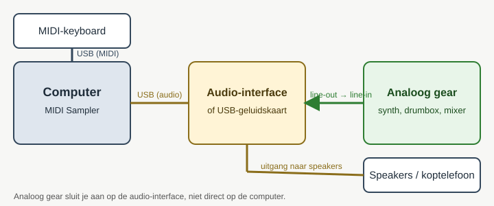
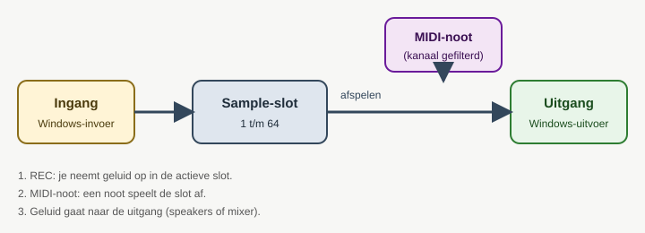

# MIDI Sampler — Handleiding

Welkom. Deze handleiding legt uit hoe je de MIDI Sampler aansluit, installeert en gebruikt. Korte stappen, veel plaatjes.

## Inhoud

1. [Wat is de MIDI Sampler?](#1-wat-is-de-midi-sampler)
2. [Aansluiten](#2-aansluiten)
3. [Installeren](#3-installeren)
4. [Gebruiken](#4-gebruiken)
5. [Creatief gebruik](#5-creatief-gebruik)
6. [Let op](#6-let-op)

---

## 1. Wat is de MIDI Sampler?


- Je neemt geluid op met REC.
- Je speelt het geluid af met een MIDI-keyboard.
- Je hebt 64 sample-slots.
- Je past per slot aan: ADSR, EQ, volume en pan.

---

## 2. Aansluiten



### Stap 1: Zet alles uit

- Zet je versterker en speakers uit.
- Zet je computer aan.

### Stap 2: Sluit je MIDI-keyboard aan

1. Steek de USB-kabel van je MIDI-keyboard in de computer.
2. Wacht tot Windows het apparaat herkent.

### Stap 3: Sluit je analoog gear aan

1. Gebruik een audio-interface of USB-geluidskaart.
2. Verbind de line-out van je synth of drumbox met een ingang van de interface.
3. Gebruik de interface als je geluid op de computer wil opnemen.

> Let op: sluit analoog gear nooit direct op de microfoon-ingang van de PC. Gebruik een line-ingang.

### Stap 4: Sluit je speakers aan

1. Verbind de uitgang van de interface met je speakers of mixer.
2. Zet het volume laag, voordat je iets afspeelt.

### Stap 5: Kies het juiste apparaat in Windows

1. Klik op het luidsprekericoon in de taakbalk.
2. Kies je interface als uitvoer.
3. Ga naar **Instellingen > Systeem > Geluid** en kies je interface als invoer.
4. In de sampler: menu **Settings** kiest het invoer- en uitvoerapparaat (Select Audio Input / Select Audio Output) en het MIDI-apparaat (Select MIDI Device).

---

## 3. Installeren

### Optie 1: Installeren met de installer (aanbevolen)

Je hebt geen Python of terminal nodig.

1. Download `MIDI_Sampler_Setup.exe`.
2. Dubbelklik op het bestand.
3. Klik op **Volgende** tot het klaar is. Laat het vinkje staan om de app meteen te starten.
4. Start de app daarna via het **Startmenu** (zoek op "MIDI Sampler").

> Tip: wil je een icoon op het bureaublad? Zet dan het vinkje bij "Snelkoppeling op het bureaublad maken".

> Windows waarschuwt misschien: "Windows heeft uw pc beschermd". Klik op **Meer informatie** en dan op **Toch uitvoeren**.

### Optie 2: Vanuit de broncode

1. Open een terminal in de projectmap.
2. Maak een virtuele omgeving:

   ```powershell
   python -m venv venv
   venv\Scripts\activate
   ```

3. Installeer de benodigde pakketten:

   ```powershell
   pip install -r requirements.txt
   ```

4. Start de app:

   ```powershell
   python main.py
   ```

---

## 4. Gebruiken


### 4.1 Geluid opnemen

1. Druk op **REC**. Het lampje gaat aan.
2. Speel geluid. De opname start zodra het geluid hard genoeg is.
3. Druk op **STOP**. Het geluid wordt opgeslagen in de actieve slot.

### 4.2 Geluid afspelen

1. Druk op **PLAY**. De actieve slot speelt af.
2. Druk op **STOP** om te stoppen.

### 4.3 Een slot kiezen

1. Druk op de linker **SELECT**-knop.
2. Typ een nummer van 1 tot 64.
3. Druk op **ENTER**.

### 4.4 Een MIDI-kanaal kiezen

1. Druk op de rechter **SELECT**-knop.
2. Typ een nummer van 1 tot 16.
3. Druk op **ENTER**.

### 4.5 Het geluid bewerken

| Bediening | Wat doet het? |
|---|---|
| **a / d / s / r** | Attack, decay, sustain, release (hoe het geluid begint en eindigt) |
| **l / m / h** | EQ laag, midden, hoog |
| **main vol** (draaiknop) | Volume van de slot |
| **pan** (schuif onder mute) | Links of rechts |
| **mute** | Zet de slot stil |

> Tip: beweeg een schuifje eerst een klein beetje. Daarna werkt de schuif zoals je verwacht.

### 4.6 Ongedaan maken

- **Ctrl + Z**: ongedaan maken.
- **Ctrl + Alt + Z**: opnieuw.

### 4.7 Opslaan en openen

1. Ga naar het menu **File** en kies opslaan (Save of Save As).
2. Ga naar **File > Open** om een project te laden.

> Let op: projecten zijn `.pkl`-bestanden. Open alleen bestanden die je zelf hebt gemaakt.

### 4.8 MIDI-noten

- Slot 1 speelt MIDI-noot 28.
- Slot n speelt MIDI-noot 27 + n.
- Een slot speelt alleen als het MIDI-kanaal klopt.



---

## 5. Creatief gebruik

- **Drumkit:** neem elke drum op in een eigen slot. Speel ze vanaf je keyboard.
- **Korte stukjes:** neem een korte vocal- of gitaarfrase op. Speel hem af als losse noot.
- **Korte klanken:** zet attack en decay laag. Dan start en stopt de slot direct.
- **Live-opnemen:** neem je synth op en speel de opname vanaf je keyboard of sequencer.

---

## 6. Let op

- De sampler past geen toonhoogte aan. Een noot speelt altijd de opname af zoals die is.
- Opnemen gebruikt het Windows-standaard invoerapparaat.
- Het afspelen gebruikt het Windows-standaard uitvoerapparaat.
- Koppel een apparaat nooit tijdens het opnemen. Dat kan een foutmelding geven.
